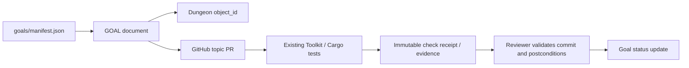

# GitHub and agent goal workflow

The agent workflow uses existing GitHub PR review, stable Dungeon object IDs and a small goal/check registry. This is **not** an alternative test runner.

Agent updates are proposed through PRs. Reviewer may mark VERIFIED only with actual source-bound execution evidence and passing required checks. Unknown/blocked requirements never silently become success. On new commits invalidate currency of prior receipts. No auto-merges, no cross-agent ownership inheritance, no container/VM runtime.

The disabled [Codex Issue route](codex-issue-runner.md) consumes this same registry. It requires an existing indexed `MSS-XXX` GOAL and an owner-reviewed execution scope. A controller records TODO to IN_PROGRESS on a new topic branch, then creates a Draft PR before recording IN_REVIEW (independent required checks passed) or BLOCKED. The code commit is tested before the later receipt/status commit, so `source_commit` identifies the tested version without a self-reference. Only an independent reviewer may transition IN_REVIEW to VERIFIED.

Relevant references: [Dungeon System](https://github.com/paulgreenbox-beep/dungeon-system), [Rust Makepad Toolkit](https://github.com/paulgreenbox-beep/rust-makepad-toolkit).
