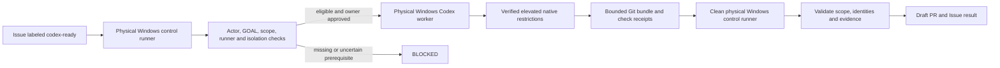

# Codex Issue dispatcher on physical Windows runners

## Offline review commands

Run `node --test scripts/codex-issue/test/dispatcher.test.mjs`, then `node --check scripts/codex-issue/run.mjs` and `git diff --check`. The blackbox test initializes and removes only its own temporary Git fixture; this desktop's restricted permission mode requires a scoped execution grant for that fixture. It traps network access and model/broker subprocesses.

For YAML syntax and parsed permission checks, run `node scripts/codex-issue/validate-workflow.mjs <installed-yaml-module>`. The validator accepts the `yaml` package or an existing module exporting `.yaml`. This task used the already bundled Playwright YAML parser; no dependency was installed. This checks YAML syntax and the stated offline contracts, not the GitHub Actions engine. No inference or paid API canary is part of these commands.

Checkout is pinned to `11d5960a326750d5838078e36cf38b85af677262`, upload-artifact to `ea165f8d65b6e75b540449e92b4886f43607fa02`, and download-artifact to `d3f86a106a0bac45b974a628896c90dbdf5c8093`. The OpenAI action/CLI pins and authentication analysis are recorded below. No Rust dependency or upstream source is changed.

The existing hourly chat worker uses `agent-ready`, a different route. Pause it or otherwise explicitly exclude the same Issues before enabling this Actions dispatcher; the two routes must not independently claim the same task.

## Status and review boundary

This integration is prepared for owner review and is **disabled by default**. The repository policy has `enabled: false`, `isolation.approved: false`, and an empty `scopes` object. The repository variable `MSS_CODEX_ENABLE` must also be explicitly set to `true` before execution can become eligible. Changing either setting alone is insufficient.

The workflow and its offline tests are orchestration code. They are not evidence that a physical runner, native Windows boundary, secret handling, model call, or generated application has passed acceptance. No real Codex model invocation or API-token test is authorized by this change. Those integration results remain `NOT_VERIFIED` until the owner separately authorizes and observes them.

This PR is stacked on the goal-management work in PR #5. It consumes that existing `goals/manifest.json`, `goals/MSS-XXX.json`, check catalog, and status vocabulary. It does not replace that system, alter PR #1–#5 branches, or treat their draft implementations as merged dependencies.

## Execution architecture

The event is `issues: labeled`, with an exact `codex-ready` label gate. A concurrency group containing the repository and Issue number serializes deliveries for that Issue. A duplicate delivery, rerun, existing task branch, uncertain prior write, or competing claim must not start a second mutation attempt.



There are three jobs with separate responsibilities:

1. **Control/preflight:** read the current trusted default-branch policy, authorize the actual label-event sender, resolve the declared GOAL and dependencies, verify scope, detect prior attempts, and check the exact worker runner inventory. It never evaluates Issue text as code.
2. **Generation:** run on the selected physical Windows worker after the protected-environment approval. Keep a trusted helper checkout separate from the agent's task workspace. Give Codex only read access to GitHub and bounded native access to the task files. Deliver changes as a size-bounded Git bundle, not an executable script or arbitrary path supplied by the agent.
3. **Publication:** use a fresh trusted checkout on the control runner. Treat the bundle and model output as untrusted. Verify allowed paths, protected files, unchanged SKLT identities, selected-GOAL changes, source identities, and independent check receipts before creating `codex/issue-<number>` and a Draft PR. This job has the scoped GitHub write permissions and no model API key.

Publication does not execute scripts, hooks, tests, or dependency installers from the generated branch. Trusted orchestration must not be loaded from files that the agent was allowed to modify. The generated source, including Rust `build.rs`, test fixtures, and dependency lifecycle code, remains untrusted code and must run only inside the separately verified native restrictions.

## Event authorization and untrusted data

An Issue author's identity does not authorize execution. The gate checks the sender of the label event and its current repository permission, and binds approval to the policy's authorized numeric user IDs. Bots, identity mismatches, missing identity, and failed permission lookups do not gain permission by supplying a familiar login or by mentioning the owner. Rerun provenance must also be checked rather than assuming the rerun actor is the original approver.

The control job resolves the Issue and relevant source at exact revisions. It must stop if the Issue scope, label state, dependency state, or ownership becomes inconsistent with that approved snapshot. Issue bodies, comments, titles, attachments, PR source, and model output are data. They cannot set trusted workflow instructions, shell programs, allowed paths, check commands, model arguments, network destinations, or credentials.

The trusted prompt tells Codex to read `AGENTS.md`, `SECURITY.md`, the selected GOAL and its SKLT objects. Task text is supplied as explicitly untrusted task context. Delimiting task text is not itself a security boundary; authorization, native permissions, scope validation, and independent checks enforce the boundary.

## GOAL and scope handling

The Issue declares exactly one existing GOAL using `MSS-GOAL: MSS-XXX`. Resolve it through `goals/manifest.json`; reject an absent, malformed, ambiguous, unindexed, or invalid GOAL. Do not create a GOAL from Issue text. Its dependencies and required check IDs must be valid before work begins.

`.github/codex-issue-policy.json` contains owner-reviewed **execution scopes**: `scopes.<GOAL>.paths` holds relative directory prefixes ending in `/`, and `scopes.<GOAL>.checks` holds admitted check IDs. These scopes are not a second task registry. The GOAL retains its purpose, scope, acceptance criteria, dependencies, and required check obligations. An empty `scopes` object authorizes no task. A catalog command is executable only when its literal argument array is also admitted by policy; mismatches are `BLOCKED`, not silently repaired or normalized.

GOAL changes are reviewable branch changes, never direct writes to `main`:

| Transition | Authority and evidence |
|---|---|
| `TODO → IN_PROGRESS` | Authorized dispatch with a valid GOAL, satisfied dependencies, confirmed ownership, and exact base SHA. |
| `IN_PROGRESS → IN_REVIEW` | Bounded implementation, required independent check results, confirmed Draft PR, and exact source/evidence references. |
| `IN_PROGRESS → BLOCKED` | Named missing prerequisite, failed check, failed Codex, invalid generated change, or unresolved outcome. Preserve the reason and evidence. |
| `IN_REVIEW → VERIFIED` | Independent owner/verifier review only. The agent and dispatcher cannot set `VERIFIED`. |

A failure before a valid GOAL has been resolved can only produce a dispatch error/`BLOCKED` report; it cannot authorize inventing or editing a replacement GOAL. A pre-dispatch refusal must not fabricate a completed `IN_PROGRESS` execution. The selected GOAL's required checks are not removed to make publication succeed. `PASS`, `FAIL`, `BLOCKED`, `NOT_RUN`, and `UNKNOWN` retain their documented meanings.

Every check receipt must identify the exact tested commit SHA, literal command, result/exit code, source and evidence hashes, and the relevant GOAL/check ID. The publisher must independently validate the receipt against the admitted check and delivered source. A model assertion, action success, command acknowledgement, a Git bundle, or a green workflow is not a check receipt or Toolkit parity proof. If the delivered source changes, older receipts do not remain current automatically.

## Required native check broker

The policy names the fixed protected path `C:\ProgramData\MSS-Codex\check-broker.exe` and its expected SHA-256. The broker must be separately implemented, reviewed, installed, and qualified by the owner. **This PR does not implement or supply that broker.** Its absence, an unexpected digest, or missing independent isolation evidence is `BLOCKED`.

The broker is an OS-native boundary for executing only literal command arrays from the existing catalog and policy inside the verified Windows restrictions. It must not accept shell command strings, Issue-provided executables, arbitrary working directories, or unchecked command arguments. It must bind receipts to the exact source bytes and record process identity, bounded timeout/cancellation, result, evidence hashes, and owned-resource cleanup. It must not expose unrestricted process control, host filesystem writes, network access, or secrets to generated code.

The trusted controller starts the pinned broker executable with no command-line arguments and sends one bounded JSON request on stdin. The fields are:

```json
{
  "schema": "mss-native-check-request-v1",
  "goal": "MSS-XXX",
  "attempt": "123456789",
  "source_commit": "<exact 40-character lowercase Git commit SHA>",
  "workspace": "C:\\MSS-Runner\\work\\agent",
  "checkout_mode": "fresh-exact-commit",
  "checks": [
    {
      "id": "RUST_FMT",
      "description": "Rust formatting",
      "command": ["cargo", "fmt", "--all", "--", "--check"],
      "requires": ["exit_code", "commit_sha"]
    }
  ]
}
```

This is an illustrative protocol shape; replace the placeholder GOAL/SHA with validated values. `attempt` is the decimal GitHub **run ID**, serialized as a string, not the workflow rerun counter. `checks` contains the selected existing catalog entries, with exact command arrays. The broker must independently validate every field and resolve `workspace` within its own approved work root. It must resolve tool names to reviewed executables rather than execute a workspace-supplied `cargo` or other shadow executable.

`fresh-exact-commit` is mandatory: the broker must create its own clean, bounded checkout of `source_commit` and run the admitted checks there. It must not test the agent's mutable workspace in place, copy ignored/untracked files, reuse an agent-modified `target` directory, load agent Git hooks/configuration, or trust a pre-existing checkout because its visible HEAD matches. This prevents ignored files or source changes outside the committed bundle from influencing a supposedly source-bound result. Creation, cancellation and cleanup must affect only directories and processes owned by that broker attempt.

On success, stdout is a JSON **array** of receipts, exactly one per admitted check. A receipt has this shape:

```json
[
  {
    "schema": "mss-check-receipt-v1",
    "goal_id": "MSS-XXX",
    "attempt": "123456789",
    "check_id": "RUST_FMT",
    "source_commit": "<exact 40-character lowercase Git commit SHA>",
    "runner": "physical-windows-worker-identity",
    "started_at": "2026-10-30T10:00:00.000Z",
    "ended_at": "2026-10-30T10:00:01.000Z",
    "command": ["cargo", "fmt", "--all", "--", "--check"],
    "result": "PASS",
    "exit_code": 0,
    "evidence": [
      {"ref": "sha256:<64-character lowercase hex>", "sha256": "<same 64-character lowercase hex>"}
    ]
  }
]
```

The example is not a recorded PASS. `result` is one of `PASS`, `FAIL`, `BLOCKED`, `UNKNOWN`, or `NOT_RUN`. A PASS requires exit code zero and nonempty evidence whose `ref` is exactly `sha256:` followed by its `sha256` value. Bind the receipt to the requested GOAL, run ID, exact source commit, check ID, command, real runner identity, and ordered timestamps. The evidence bytes must exist in the approved bounded evidence store and match the digest; do not substitute a fabricated hash or raw secret-bearing log path. The publisher writes safe receipt references under `goals/events/`. Malformed/missing/duplicate/stale receipts, nonzero broker exit, timeout, or uncertain completion block publication as `IN_REVIEW`; no automatic retry is permitted.

Before enabling dispatch, independently prove denied access outside admitted paths, denied writes to orchestration/configuration and other repositories, restricted network destinations, absence of secret inheritance, bounded child-process lifetime, and cleanup of only owned processes. An attestation string, binary digest, or runner label cannot replace that live qualification.

## Why Windows uses the action's `unsafe` strategy

The researched action revision is [`openai/codex-action@c05cfd74ad95c626cdf05c6685e62becc3bf7813`](https://github.com/openai/codex-action/tree/c05cfd74ad95c626cdf05c6685e62becc3bf7813). Its [action metadata](https://github.com/openai/codex-action/blob/c05cfd74ad95c626cdf05c6685e62becc3bf7813/action.yml) accepts only `safety-strategy: unsafe` on Windows; `drop-sudo` and the UNIX `unprivileged-user` strategy do not provide a Windows boundary. The pinned Codex CLI package is `0.166.0` ([release](https://github.com/openai/codex/releases/tag/rust-v0.166.0)). Do not replace these pins with floating `main` or `latest` during setup.

The action's [`determinePermissionSelection`](https://github.com/openai/codex-action/blob/c05cfd74ad95c626cdf05c6685e62becc3bf7813/src/runCodexExec.ts) still applies a selected `permission-profile` when the action strategy is `unsafe`. That preserves profile argument validation; it does not establish host privilege isolation by itself. This workflow relies on separately provisioned and independently verified Windows controls. It must remain disabled until those controls are approved.

Use the native legacy **elevated** implementation with dedicated lower-privilege command users, filesystem ACLs, and firewall policy. Commands must run without administrator privileges. Set managed `windows.allow_mxc = false` and permit only the `elevated` legacy implementation; do not fall back to `unelevated`. MXC is Microsoft Execution Containers and is excluded by MSS's no-container requirement, even when it uses native process isolation. No Docker, WSL, WSLC, Hyper-V, VM, or virtualized worker is allowed.

The fixed protected Codex home is `C:\ProgramData\MSS-Codex\codex-home`; its reviewed `config.toml` must match `isolation.config_sha256`. **System managed requirements are not loaded from `CODEX_HOME/requirements.toml`.** For Codex `0.166.0`, the Windows default is the Windows ProgramData known folder followed by `OpenAI\Codex\requirements.toml`, normally `C:\ProgramData\OpenAI\Codex\requirements.toml`. The 64-bit registry value `HKLM\SOFTWARE\Policies\OpenAI\Codex\RequirementsPath`, when present, selects a different absolute file first. The worker must reject a differing override for this fixed-path deployment, or a separately reviewed implementation must resolve and hash the actual effective path; hashing an unused copy does not prove policy enforcement. `isolation.requirements_sha256` must bind that effective system file. See the [pinned Windows path loader](https://github.com/openai/codex/blob/rust-v0.166.0/codex-rs/config/src/loader/mod.rs#L819) and [managed configuration locations](https://learn.chatgpt.com/docs/enterprise/managed-configuration#locations-and-precedence).

The effective system requirements must contain:

```toml
[windows]
allowed_sandbox_implementations = ["elevated"]
allow_mxc = false
```

These are recognized requirement keys in the [pinned `WindowsRequirementsToml` source](https://github.com/openai/codex/blob/rust-v0.166.0/codex-rs/config/src/config_requirements.rs#L888). The implementation allowlist alone does not block MXC; both fields are required. Protect the files and their parent namespaces against replacement, including the ProgramData `OpenAI\Codex` directory and the applicable registry policy key. Independently inspect effective loaded requirements; a matching file hash alone cannot rule out other managed layers or prove native enforcement.

Use a narrow named permission profile and `approval_policy = "never"`; do not mix permission profiles with legacy `sandbox_mode`/`--sandbox` settings, grant extra writable roots, enable approval bypass, or load agent-controlled configuration. Block access to the runner installation, host credentials, control checkout, broker, Codex home, policy, other repositories, and all paths outside the admitted workspace/runtime minimum. Scope controls also protect `.git`, instruction files, workflow code, GOAL authority, and stable SKLT `object_id` values. GLIF/GLYF work is excluded.

Provisioning is an administrator task performed separately on the intended service identity. The official [Windows sandbox guide](https://learn.chatgpt.com/docs/windows/windows-sandbox) describes native elevated setup and managed restrictions. Its commands are reference material, not a claim that this PR installed or proved those controls. Test the exact pinned version and effective requirements on the actual host before allowing API expense.

## Credentials and GitHub permissions

| Credential or permission | Holder and purpose |
|---|---|
| `OPENAI_API_KEY` Actions Secret | Released only to the Codex action input in the approved generation job. Never job-level environment, repository file, Issue/PR text, evidence, or artifact. |
| `MSS_RUNNER_READ_TOKEN` Actions Secret | Control preflight only; repository Administration **read** permission to inspect self-hosted runner inventory. No model access. |
| Generation `GITHUB_TOKEN` | Repository contents read only. No branch push, Issue update, PR publication, or merge authority. |
| Publisher `GITHUB_TOKEN` | Minimum `contents: write`, `pull-requests: write`, and `issues: write` needed for the exact task branch, Draft PR, and result comment. No model key and no administration/branch-protection permission. |

Use a dedicated `mss-codex-owner-approved` GitHub environment with an owner reviewer and a deployment-branch rule restricted to the trusted default branch. Disable self-review where the repository plan permits it. Protect `main` and the workflow/policy paths; do not grant the workflow identity a ruleset bypass. GitHub token scopes do not restrict writes to one branch by themselves, so branch rules and trusted publication validation are required. The agent is never given the publisher token and cannot push directly to `main`.

The action starts a Responses API proxy to reduce exposure of the provider key. Do not replace it with a direct `CODEX_API_KEY` environment variable inherited by build/test processes. Do not seed personal `auth.json` onto this public repository's runner. GitHub log masking alone is not a secret boundary, and raw model transcripts must not be published as evidence. See [official action guidance](https://learn.chatgpt.com/docs/github-action) and [non-interactive authentication guidance](https://learn.chatgpt.com/docs/non-interactive-mode).

## Owner setup and safe enablement

1. Review and merge the goal-registry dependency PR #5 and this integration through the normal PR process. Keep execution disabled during review. Rebase/retarget the stacked PR only after checking the resulting trusted source and tests; never overwrite PR #1–#5 branches.
2. Prepare dedicated **physical** Windows control and worker machines. Register only the intended repository and trusted workflow with their self-hosted runner groups. Use the required labels, including the exact worker runner ID in policy. Do not use a normal personal workstation with unrelated credentials or applications.
3. Protect runner service identities, installations, work roots, and control data with reviewed ACLs. Keep the worker account nonadministrator. Preinstall reviewed tools and dependency caches; the agent is not allowed to install executables or change host configuration.
4. Provision the native elevated sandbox as administrator, explicitly disable MXC and unelevated fallback, and install the reviewed named profile in the protected Codex home. Install requirements at the actual system location `C:\ProgramData\OpenAI\Codex\requirements.toml` for the default ProgramData layout; reject or separately review any registry `RequirementsPath` override. Qualify the effective restrictions on the actual worker. Record independent evidence, hashes, version, host identity, and approval.
5. Separately install and qualify the native check broker. Admit only required catalog check IDs and literal command arrays. Verify failure, timeout, cancellation, secret exclusion, source binding, and owned-process cleanup. A missing broker must continue to block execution.
6. Review network policy: allow only required GitHub control/publication traffic and the action's model proxy path; block arbitrary command egress and access to host-local services. Do not infer network isolation from a local control endpoint or a firewall checkbox.
7. Configure the `mss-codex-owner-approved` environment reviewer and default-branch restriction. Create the two Secrets listed above with the narrow scopes. Configure repository permission to let the trusted publisher create Draft PRs, and branch rules preventing workflow push to `main`, merge, or protection changes.
8. Populate the repository policy's exact worker identity, independent isolation evidence and digests, and owner-reviewed execution scopes. Resolve any policy/catalog mismatch explicitly. `scopes` must name existing GOAL/check IDs and only necessary relative file paths. Do not add a new task or GOAL from an Issue automatically.
9. Run offline authorization/routing tests and the no-model native qualification. Inspect the tested commit and evidence. Obtain separate owner approval for a bounded API canary and its budget; this PR grants no such approval.
10. Only after those reviews, set the committed policy's enable/approval fields and `MSS_CODEX_ENABLE=true`. Adding `codex-ready` then becomes an expense-bearing approval, so restrict that action to authorized users. To stop dispatch, clear the variable or set policy `enabled` to false. Do not auto-replay a queued or uncertain mutation after changing settings.

The control runner uses the runner-inventory token to detect a missing, offline, busy, or mismatched **worker** before scheduling generation. If the control runner itself is unavailable, GitHub queues the job before repository code runs; it cannot emit an Issue `BLOCKED` report in that condition. The owner must monitor queued runs and maintain the physical control runner. A GitHub-hosted fallback would violate MSS's no-VM constraint and is not provided.

## Example Issue

Create a normal Issue without automatic labels. Replace `MSS-XXX` with an existing eligible GOAL ID from the manifest:

```text
MSS-GOAL: MSS-XXX

Requested change:
Describe the bounded behavior required by the existing GOAL.

Acceptance:
- State the observable result and negative cases.
- Identify relevant existing check IDs and expected evidence.

Dependencies:
List prerequisite merged PRs or GOALs; do not treat draft code as accepted.

Constraints:
Keep the existing Toolkit contract and SKLT object_id values.
No changes to external projects, GLIF/GLYF, host setup, or credentials.
```

The owner first reviews the current Issue, eligible GOAL, policy scope and dependencies, then deliberately adds `codex-ready`. Merely creating an Issue, writing a comment, using `agent-ready`, or editing the sample does not dispatch Codex.

## Failure, evidence, and recovery

Missing/invalid GOAL, absent or invalid secret, unavailable worker, absent broker, mismatched isolation hash, denied sender, unapproved scope, failed Codex, failed independent check, invalid bundle, or protected-file change cannot produce acceptance. Report the specific refusal/failure as `BLOCKED` or the documented check result, retain bounded evidence, and stop. Required checks that did not execute are `NOT_RUN` with a reason.

A write timeout or lost response after dispatch is an uncertain outcome. Do not automatically retry branch creation, push, Draft PR creation, status writes, or Issue comments. Independently inspect the exact existing state and require explicit recovery where the result cannot be resolved. Never force-push, auto-merge, alter branch protection, take another agent's task, or set `VERIFIED` to make a run appear complete.

Keep the implementation review distinct from live integration:

| Surface | Evidence required before claiming success |
|---|---|
| Workflow/routing implementation | Parsed workflow, authorization/replay/GOAL/failure tests, scope and permission checks at the exact PR commit. No model calls. |
| Native runner qualification | Actual physical-host identity, service/ACL/firewall/profile/provisioning proof and denied-operation probes. |
| Check broker | Reviewed installed binary digest plus independent command, source, receipt, failure, cancellation and cleanup proof. |
| Live Codex-to-Draft-PR integration | Separately authorized API canary, bounded spend, generated source, independent check receipts, confirmed Draft PR/Issue/GOAL outcomes. |
| Toolkit/runtime acceptance | Full relevant Toolkit and MSS contracts with exact source-bound evidence; no inference from a dispatcher unit test. |

The last four rows remain `NOT_VERIFIED` until their evidence exists. Absence of runner/secret/broker is a named blocker, not a simulated successful execution.
