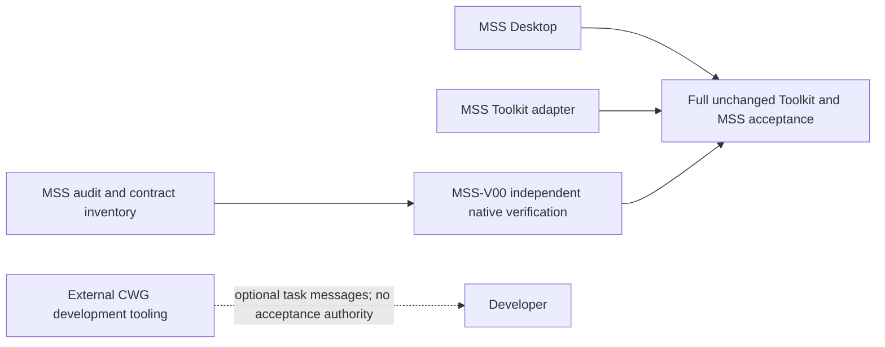

# MSS / CWG: independent product and development transport

Owner decision: CWG is a separate project, not an MSS module or required runtime/build/acceptance service. This document supersedes scheduling dependencies in the 2026-10-30 master plan; it does not overwrite historical source or results.

## Responsibilities

| Remains in MSS | Belongs to external CWG |
|---|---|
| All eight MSS modules, including GUI-facing MSS_MCP | GitHub event ingestion and chat/thread routing |
| App/test process ownership and addressed GUI input | Development-agent Issue dispatcher and chat delivery |
| SDK semantic observations and app-originated frames | Development worker orchestration and optional check broker |
| Toolkit runner, scheduler adaptation, postconditions and evidence | Generic reusable GOAL workflow tooling |
| Project-local GOAL definitions, acceptance/check catalog and receipts | Authentication/replay of GitHub-to-chat messages |

MSS_MCP controls MSS applications through MSS_API. CWG_MCP transports task messages to an agent. They must not be merged into one server. A chat binding is not authority over an MSS app session.

MSS can be built, manually verified and operated without CWG, a GitHub token, a model API key or a running chat bridge. Optional use of CWG by a developer grants no additional app/process authority and does not replace MSS's evidence or security requirements.

## Effective plan, not a rewritten history

The immutable archive has 14 product packages A00-A13 and eight infrastructure packages B00-B07. `plans/mss-scope-v2.json` and `../scripts/mss_scope.py` derive two separate scheduling views from six hash-pinned original data files:

- A00-A13 remain MSS. A13 depends on A09, A12 and **MSS-V00**, not B06.
- A02's potential CI activation is gated by MSS-V00, not a CWG implementation.
- MSS-V00 is an independently reviewed physical native verification/evidence profile. It is PLANNED_NOT_STARTED, not a new executor or a qualified broker.
- B00-B07 become a source handoff to `paulgreenbox-beep/Chat_Worker_GitHub`. B06's A02 reference becomes an external contract input, not a build/runtime dependency in either direction.
- B00 must be split semantically: generic agent workflow tooling belongs to CWG; MSS project goals and acceptance history stay in MSS. Never delete `goals/` indiscriminately.

All 112 Toolkit operations and the pinned schema/scenarios remain required. All 54 original invariants, 68 proposed checks and historical status fields are preserved without importing a PASS into a new context. Product-native equivalents of cross-cutting file/network/identity/evidence checks remain mandatory under MSS-V00. Private-desktop association/crash checks are still required when the selected MSS backend uses those mechanisms; a different design requires explicit applicability review, never a silent waiver of Toolkit behavior.

The original master plan, eight source documents and historical FAIL/BLOCKED/NOT_RUN records are not edited by the projection. In particular, Broker production/USER32 remains blocked and PR #11's fixture/fmt FAIL is not repaired or reclassified by this documentation change.



## Existing PRs and source preservation

At inspection, MSS main is `83ff50112fbbdc1cd2a43ccd2ac1650504394a67`. It contains neither dispatcher nor native-check-broker implementation. Those exist only in unmerged drafts, so there is no product binary to delete from main.

| Historical source | Handling |
|---|---|
| PR #5, `9c0e867f8844a6bc7949c7705db5c2cbbb65ef1c` | Retain project GOAL data; review any generic automation separately for CWG. |
| PR #7, `d83520d931ab000574c5c02192b9f49da86a34ea` | Do not merge the dispatcher/workflow into MSS; source reference for CWG only. |
| PR #9, `368e5c54bb3da8a65cad2db9f141041100eb4630` | Optional CWG check-broker research; no native qualification inherited. |
| PR #10, `8863cc326b99f8d76b2bf66725d87540aab79f02` | Product integration remains the engineering baseline, not yet main. |
| PR #11, `192b81ac83cfa3945318804430af25b3795609ad` | Fix Unicode fixtures and formatting; rerun before integration. |

No branch/history/evidence deletion or automatic PR closure is part of this change. CWG source extraction/adaptation must preserve pins and tests in its own reviewed PR; recording ownership is not a claim that those sources were physically copied or qualified there.

## What may proceed, and what needs checks

Use the PR #10 tree for product work; main still contains placeholders. Its recorded 44-test PASS at `352e2c317de74c67e61fa38371a99be54c606c10` applies to that tested source only.

| Module | Existing integration scope | Next work and required checks |
|---|---|---|
| MSS_Core | Logical registry; 16 tests recorded | Native ProcessLease/epoch/birth/Job lifecycle; actual Windows positive/negative cleanup and neighbor survival. |
| MSS_API | Authorization/cancellation/unsupported gate; 6 tests | Authenticated external principal, capabilities and correlated results; never accept caller-provided AgentId as credentials. |
| MSS_Remote | Intent validation; 5 tests in #10; no transport | First repair #11. Then bounded read/capture channel; ledger/unknown-outcome tests before real mutations. |
| MSS_Render | Provided-PNG validation/cache; 9 tests | Actual producer identity/freshness/renderer epoch/backpressure. Synthetic PNG tests are not GPU capture proof. |
| MSS_SDK | Placeholder, zero behavior tests | Trusted fixture, app-side observations and handshake; source review plus actual app-thread/native checks. |
| MSS_Desktop | Compiled illustrative shell, zero behavior tests | Connect authenticated selected-session frames after producer proof; stale-frame labeling, resize/reset/close and cross-session UI tests. |
| MSS_MCP | Placeholder, zero behavior tests | Thin MSS_API tools; protocol/auth/cancellation and actual client checks. No GitHub/chat dispatcher. |
| MSS_Skills | Documentation | Review against actual API/capabilities; no claims for missing tools or native behavior. |

The eight composition tests recorded in #10 are additional to 16+6+5+9 = 36 module tests, totaling 44. Do not add branch inventories to manufacture a larger passing suite. After the #11 fix, rerun its six Remote cases and the resulting complete workspace; 45 is an expected inventory, not an observed pass here.

## Reproduction and safe integration

From this checkout, with an extracted reviewed master-plan bundle:

```sh
python -m unittest discover -s scripts/tests -p test_mss_scope.py -v
python scripts/mss_scope.py --source /path/to/extracted-plan --repo . --output effective-plan.json
```

The output path must not exist. The tool does not execute any source from the archive, modify the baseline, enable a workflow, install software or run a model. The tracked-path guard refuses importing the old CWG dispatcher/broker executable directories; historical documents and project GOAL files are allowed. It is an integration hygiene check, not a sandbox or proof against deliberately modified policy/tool code.

Before merging with #10/#11, preserve all existing Rust tests, run fmt/check/test/Clippy/debug/release sequentially with the pinned lockfile, and attach exact-source results. This scope change introduces no Rust change and cannot certify any new Rust/native acceptance. Automatic untrusted build/test execution is prohibited until the corresponding native restrictions are independently qualified. A fixed trusted frame experiment has its own explicit owner-approved admission; it does not wait for CWG, nor does it authorize arbitrary generated programs.
