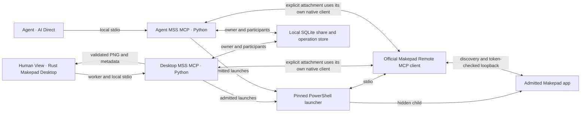
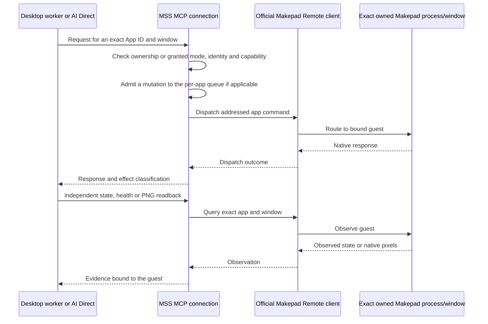
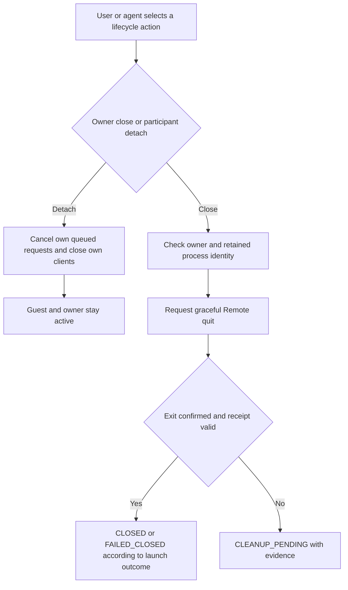
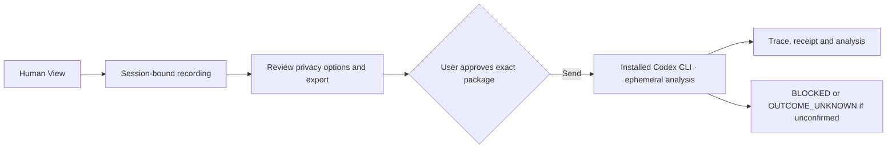

# Windows preview maps

The arrows represent the current Windows implementation. [Architecture](architecture.md) · [Security](../SECURITY.md) · [Historical maps](history/initial-architecture/maps.md)

## Human View and AI Direct

Separate instances use separate App IDs, owned process identities, launcher receipts and artifact roots. The diagram shows a representative process path. Sharing one App ID is optional and does not merge separate app instances.

## Identity, control and observation

If a dispatched mutation becomes uncertain, the app may enter `OUTCOME_UNKNOWN`. Recovery uses explicit status and observation without resending the mutation.

## Detach and owned close

## User-approved recording delivery

The handoff consumes saved data. Live application control uses the independent AI Direct path.
